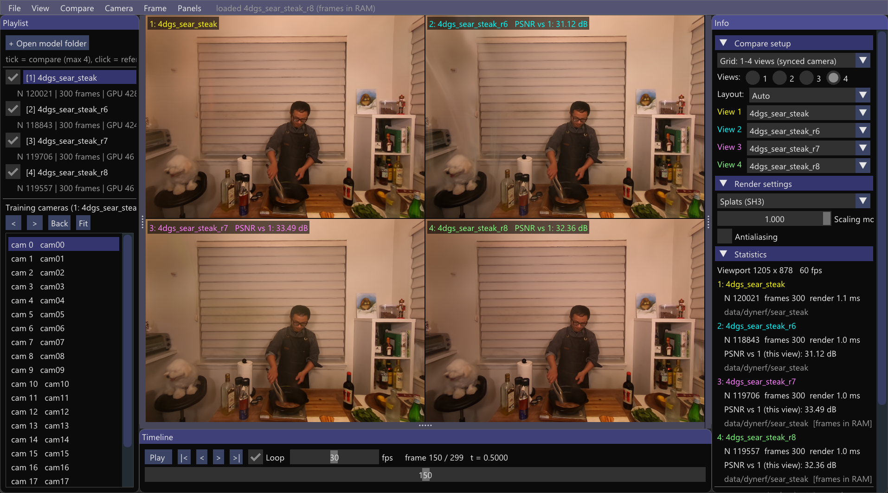
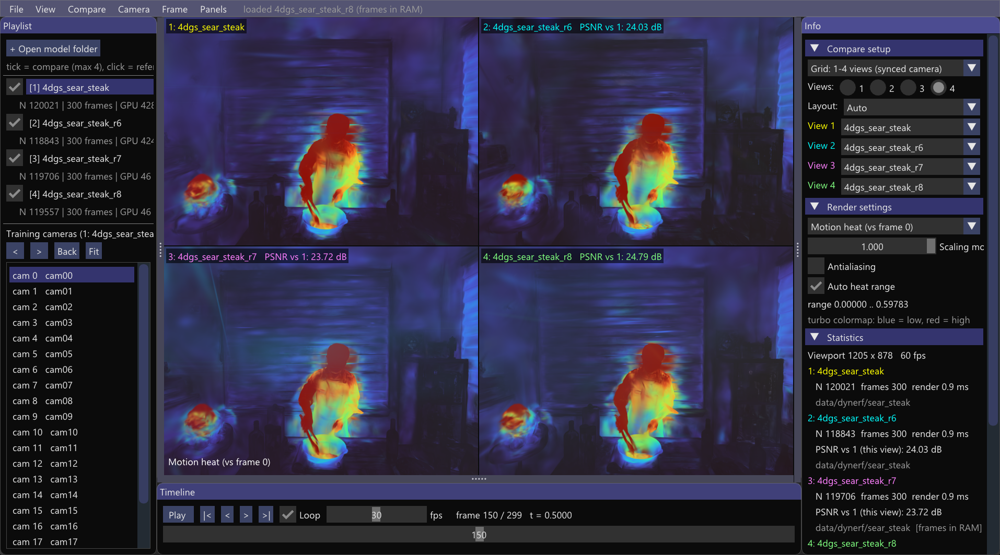
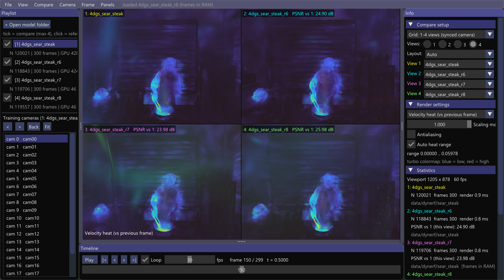
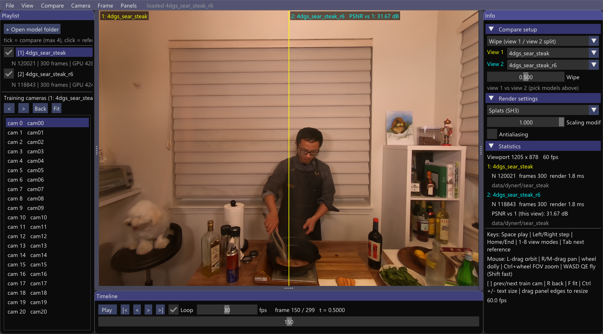
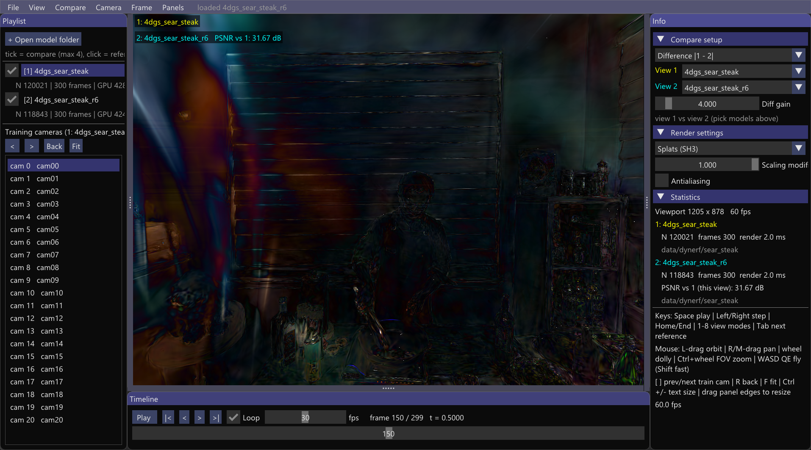
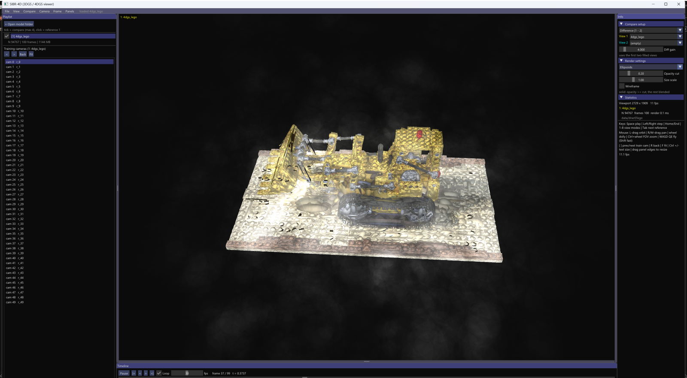

# SIBR-4D — a 4DGS viewer built on the original SIBR Gaussian viewer

SIBR-4D extends the original 3D Gaussian Splatting viewer (SIBR, Inria) with **time**: it plays back
dynamic (4D) Gaussian models frame by frame with the original CUDA rasterizer, and compares up to four models
side by side with a synchronised camera.


<sub>Four 4D Gaussian Splatting runs of the same scene in a 2x2 grid with a shared camera and frame; each view shows its PSNR against view 1.</sub>

| Motion heat map (movement since frame 0) | Velocity heat map (movement since the previous frame) |
|---|---|
|  |  |
| **Wipe** (drag the split line) | **Difference** \|view 1 - view 2\| x gain |
|  |  |


<sub>Ellipsoids view with its settings (opacity cut, size scale, wireframe). Scenes: Neu3D *sear_steak* (Li et al., CVPR 2022, CC BY-NC 4.0) and D-NeRF *lego* (Pumarola et al., CVPR 2021).</sub>

* Original 3DGS rendering quality (official rasterizer, SH degree 3)
* Timeline: play / pause / step, loop, playback speed
* Compare 1-4 models: grid (row / column / 2x2), wipe split, difference |1-2|, overlay blend, flicker
* PSNR between views and per-pixel values under the mouse
* View modes: splats, DC colour, points, motion / velocity / opacity / scale heat maps, ellipsoids
* Orbit / pan / zoom / FOV zoom / fly camera, snapping to training cameras
* Drag and drop of model folders, resizable panels, adjustable UI text size

A detailed guide (Korean) is in [`docs/SIBR-4D_manual_ko.pdf`](docs/SIBR-4D_manual_ko.pdf).

For analysing static 3DGS models (GT evaluation, multi-scale evaluation, anti-aliasing and zoom, flicker along camera
paths, pruning simulation, training-progress playback), use the companion viewer
[SIBR-3D](https://github.com/DonghoLEE-CV/3dgs-sibr-analyzer) (`3dgs-sibr-analyzer`).

## Requirements

* Windows 10 / 11 (64-bit) and an NVIDIA GPU with compute capability 7.0 or newer, recent driver
* Visual Studio 2022 (Community or Build Tools) with **Desktop development with C++**
* Git for Windows, Miniconda (or Anaconda)
* About 12 GB of free disk space and an internet connection for the first setup

`setup.bat` checks all of these and offers to install missing ones with `winget`.

## Install

```bat
git clone https://github.com/DonghoLEE-CV/4dgs-sibr-viewer.git
cd 4dgs-sibr-viewer
setup.bat
```

Setup creates everything inside the repository folder (`env\`, `third_party\`, `logs\`):
a conda environment with Python 3.10, the CUDA 12.4 compiler and PyTorch 2.5.1, the pinned SIBR and
4DGaussians sources, and the built viewer. The first run takes 20-40 minutes.

Dependencies are listed in [`environment.yml`](environment.yml) (conda: Python, CUDA toolkit) and
[`requirements.txt`](requirements.txt) (pip: PyTorch, NumPy, CMake, Ninja); `setup.bat` installs both.
To prepare the environment by hand instead:

```bat
conda env create -p .\env -f environment.yml
.\env\python.exe -m pip install -r requirements.txt
```

## Use

```bat
:: open one to four model folders (or drag them onto the window)
run_viewer.bat path\to\model_A path\to\model_B

:: options: --mode 1-8 (view mode), --cmp 0-4 (single, grid, wipe, difference, overlay), --frame N, --views 1-4
run_viewer.bat path\to\model_A path\to\model_B --cmp 2 --frame 150

:: convert a 4DGaussians result into a playable model folder
export_4dgs.bat --ckpt path\to\4DGaussians\output\dynerf\sear_steak --data path\to\dynerf\sear_steak --out models\sear_steak
```

A model folder contains `cfg_args`, `cameras.json`, `point_cloud\iteration_N\point_cloud.ply` and, for 4D
models, `sequence.g4d` (all frames, written by `export_4dgs.bat`).

## Controls (short)

| Input | Action |
|---|---|
| Left drag / right or middle drag / wheel | orbit / pan / dolly |
| Ctrl + wheel | FOV zoom |
| W A S D Q E (Shift = faster) | fly |
| `[` `]`, R, F | previous / next training camera, back to it, fit scene |
| Space, Left / Right, Home / End | play, step, first / last frame |
| 1 - 8 | view mode |
| Ctrl + / Ctrl - | UI text size |

## License

Non-commercial research and evaluation use only. The viewer code is a derivative work of the SIBR
`gaussianviewer` project and the 3DGS rasterizer by Inria / MPII and follows the
[Gaussian-Splatting License](LICENSE_GAUSSIAN_SPLATTING.md); SIBR core is Apache-2.0
([LICENSE_SIBR_APACHE2.md](LICENSE_SIBR_APACHE2.md)). See [THIRD_PARTY_NOTICES.md](THIRD_PARTY_NOTICES.md)
for every dependency. No binaries, datasets or trained models are distributed in this repository.

If you use this viewer in research, please cite 3D Gaussian Splatting (Kerbl et al., SIGGRAPH 2023),
SIBR (Bonopera et al.), and the 4D method whose models you view (e.g. 4D Gaussian Splatting, Wu et al., CVPR 2024).

---

### 한국어 요약

원본 SIBR Gaussian 뷰어에 시간축(4D 재생)과 최대 4개 4DGS 모델 비교 기능을 더한 뷰어입니다.
`setup.bat` 한 번이면 필요한 환경을 이 폴더 안에 만들고 빌드합니다. 그 뒤로는 `run_viewer.bat`으로
실행하고, 4DGaussians 결과는 `export_4dgs.bat`으로 변환합니다. 자세한 설명은
`docs/SIBR-4D_manual_ko.pdf`에 있습니다. 비상업 연구·평가 용도로만 사용할 수 있습니다.
